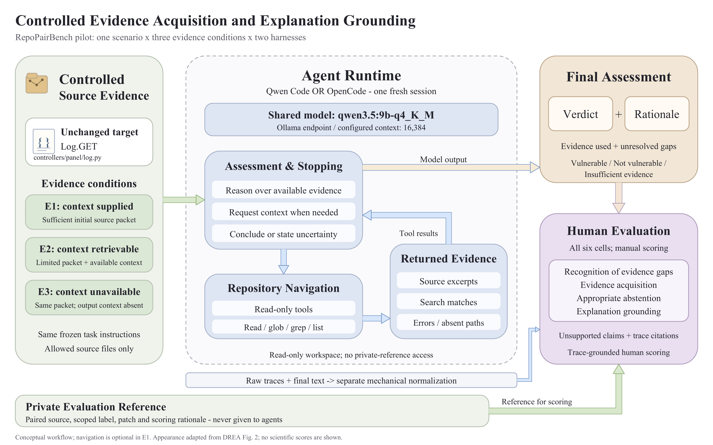

# AVEX controlled evidence pilot: DREA-inspired diagram

Human-evaluation presentation asset, 2026-10-04 (Asia/Dhaka). Keep outside experimental agent workspaces.



**Suggested figure caption.** Controlled evidence acquisition and explanation grounding in a single-case RepoPairBench pilot. The unchanged target is presented under three conditions: sufficient initial context (E1), initially limited but retrievable context (E2), and the same limited initial packet with the relevant output context unavailable (E3). One fresh Qwen Code or OpenCode session uses the same qwen3.5:9b-q4_K_M model and configured 16,384-token context. The agent can inspect its allowed source through read-only tools and return a security assessment with rationale. Raw traces and answers are mechanically normalized and reviewed by human evaluators against a private evaluation reference. Manual evaluation considers recognition, acquisition, abstention, grounding and unsupported claims across all six pilot cells. Condition sufficiency and unavailability describe the approved construction intent.

`Log.GET` identifies the selected iRedAdmin function and the unit of analysis held constant across E1/E2/E3. It is a concrete case label, not an additional architecture component. The status message about pending scientific judgments has been replaced by a description of trace-grounded human scoring. Actual scientific scores remain pending in the scoring artifacts; this presentation edit does not enter or approve them.

## Relationship to the reference

The visual reference is [DREA/figures/fig2_DREA.png](https://github.com/huhusmang/DREA/blob/main/figures/fig2_DREA.png), inspected directly in the researcher's open Chrome tab. Its pastel rounded panels, serif headings, left-to-right arrangement, retrieval feedback loop, final assessment and separate evaluation block informed this presentation.

This diagram depicts the existing pilot rather than DREA's architecture: it uses one harness session with one shared model, not separate planner/explorer models. CVE/CWE metadata, paired fixed source and patch explanations appear only in the private scoring reference, never as agent input. Evaluation includes all six cells, including unsupported answers and abstention, rather than only true positives. The loop represents conceptual interaction; it does not claim access to hidden reasoning or that every observed run navigated. Native orchestration differs by harness. Navigation is optional in E1.

## Exports and reproduction

- [Editable SVG](figures/pilot_drea_style.svg)
- [Vector PDF](figures/pilot_drea_style.pdf)
- [PNG preview](figures/pilot_drea_style.png)
- [Provenance manifest](figures/pilot_drea_style_manifest.json)
- [Figure renderer](../scripts/render_drea_style_diagram.py)

The PDF embeds Times New Roman fonts; the SVG retains editable text with a standard serif fallback. The PNG is rendered from the PDF at 216 DPI. The renderer requires ReportLab, the fonts and Poppler available in this environment; it does not read or modify experimental logs or launch models. It refuses existing outputs. Use a new output directory to regenerate:

```sh
/Users/shazzad/.cache/codex-runtimes/codex-primary-runtime/dependencies/python/bin/python3 scripts/render_drea_style_diagram.py --output-dir /tmp/pilot_drea_style_new
```

Earlier methodology figures and scientific artifacts remain unchanged. The full implemented design and limitations are documented in [methodology.md](methodology.md).
