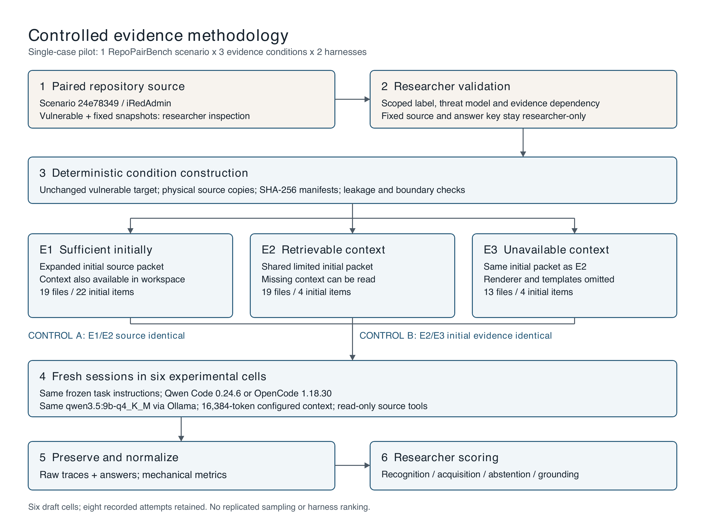
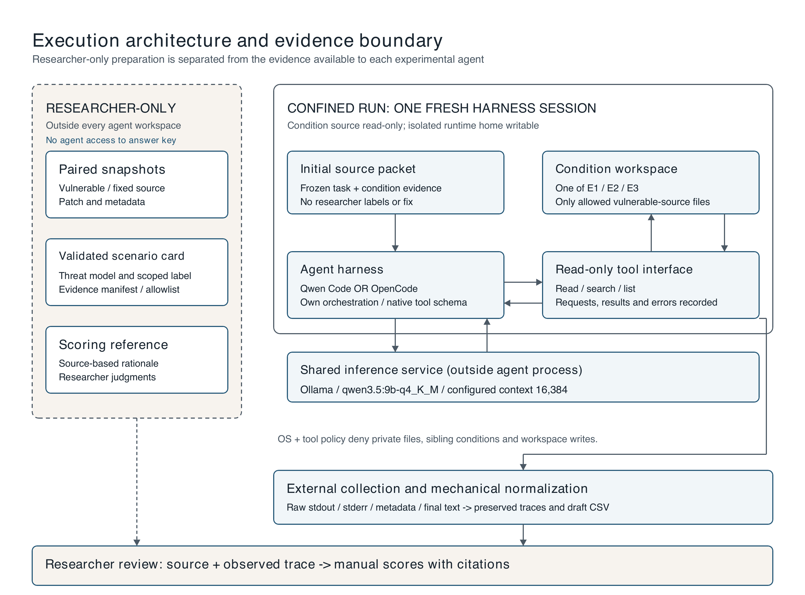
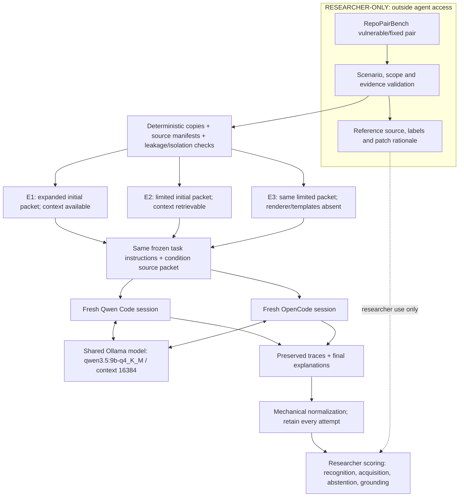

# AVEX methodology: controlled evidence acquisition and explanation grounding

**AVEX — Agentic Vulnerability EXplanations.** Project title: *AVEX: Evaluating
Evidence Grounding in Agentic Vulnerability Explanations*. This name identifies
the existing pilot; the evidence conditions, execution records and scoring
boundaries remain those documented below.

**Researcher-facing manuscript draft, 2026-10-04 (Asia/Dhaka).** This document describes the implemented pilot and its intended evaluation. It does not assign scientific scores, establish new ground truth, or rank harnesses. Researcher approval of the scenario and construction plan is recorded; interpretation of the realized conditions, attempt inclusion and run-level scoring remains a researcher responsibility. Some earlier scenario-card fields retain pre-construction status values; the build manifests and execution records establish subsequent mechanical completion.

## Study design and objective

We conducted a controlled, single-case pilot of agentic vulnerability assessment using a real vulnerable/fixed repository pair from RepoPairBench. The research question concerns how an agent responds when vulnerability-relevant program evidence is initially available, must be acquired from repository context, or is unavailable within the permitted workspace. The evaluation separates recognition of an information gap, observable evidence acquisition, handling of unresolved evidence, and grounding of the final security explanation.

The design crosses three evidence conditions with two agent harnesses, producing six experimental cells. Qwen Code CLI 0.24.6 and OpenCode 1.18.30 use the same underlying model, `qwen3.5:9b-q4_K_M`, through the local Ollama OpenAI-compatible endpoint `http://127.0.0.1:11434/v1`. Every experimental run requires `OLLAMA_CONTEXT_LENGTH=16384`. The pilot includes one draft run per cell; additional process attempts arising from infrastructure issues are preserved separately. It is a feasibility and measurement pilot, without replicated stochastic sampling or a basis for estimating population-level effects. Although the broader question concerns both harnesses and models, this pilot varies the harness and evidence condition while holding the model fixed.

**Figure 1. Controlled evidence methodology.** Paired source is inspected by the researcher to define a scoped reference assessment and an evidence dependency. Unchanged vulnerable source is then packaged into three conditions. The E1/E2 comparison holds available source constant; the E2/E3 comparison holds initially provided evidence constant. Fresh harness sessions produce preserved traces and answers for mechanical normalization and separate manual scoring. The sufficiency and unavailability labels describe the approved design intent; mechanical packaging checks alone do not prove scientific validity.

## Scenario selection and reference assessment

The researcher selected scenario `24e78349`, from the Python project iRedAdmin. The target is `Log.GET` in `controllers/panel/log.py`. The vulnerable snapshot is commit `6776a07190ecf735f40bdf759ae7f5b3b3cde6ac`; the fixed snapshot is `3c72b438d412ea3ee0270f6956e19b1098c19191`. Pair inspection, alternative-evidence searches, the security-relevant diff and approval history are retained in [scenario_validation.md](scenario_validation.md) and [scenario.json](../config/scenario.json). Neither fixed source nor researcher annotations are supplied to experimental agents.

The approved reference concerns a source-level reflected-XSS/output-encoding path. Under an already-authorized global-administrator request, default template skin, ordinary Jinja semantics and successful backend calls, request-derived filter values pass through string conversion and database-filter selection into HTML attributes. The vulnerable target retains its original local values for rendering. Its actual template interpolates these values into hidden-input attributes without explicit escaping, while the linked renderer provides no explicit autoescape option. The fixed pair adds caller-side value constraints and explicit template escaping. This establishes the scoped reference rationale; it does not certify the whole fixed application as free of vulnerabilities.

The reference does not include a reproduced historical deployment or browser exploit. Jinja dependencies are unpinned, and authenticated cross-site delivery is untested. `SameSite=Strict` is configured and is disclosed through the identical source excerpt in all three initial packets. These limits are part of the accepted threat model rather than facts to infer from an agent's output. Source-level assessment and practical exploit delivery must remain distinct when scoring.

## Evidence manipulation

Let **T** denote the unchanged target, **I** the initially supplied source packet, **W** the source files accessible through read-only tools, and **D** the contextual facts needed to resolve the selected output-encoding question under the accepted assumptions. D is a linked evidence chain: string-conversion semantics and caller data flow, database filtering that leaves caller values unchanged, the actual renderer binding/configuration, and the output sink with its relevant template context. It is not simply the existence of one filename.

The intended manipulation is: E1 supplies D initially; E2 omits D from I but makes it retrievable in W; E3 supplies the same I as E2 while omitting the renderer and template context from W. The controlled invariants are **T₁ = T₂ = T₃**, **W₁ = W₂**, and **I₂ = I₃**. These equalities are checked mechanically. Whether the remaining materials support the intended epistemic distinction requires researcher evaluation, including review of alternative evidence paths and possible prior knowledge.

| Condition | Initially supplied evidence | Accessible source | Intended diagnostic behavior |
|---|---|---|---|
| E1: sufficient initially | Shared base packet plus supporting conversion, helper, renderer and template source | 19 files, 222,188 bytes | Resolve the scoped question using supplied evidence; navigation is optional |
| E2: initially insufficient, retrievable | Target, authorization decorator, routes and shared cookie-setting excerpt | Same 19 files and bytes as E1 | Identify the gap, retrieve relevant output context and ground the conclusion |
| E3: initially insufficient, unavailable | Exactly the E2 initial packet | 13 files, 141,656 bytes | Handle the unresolved output question without inventing the omitted behavior |

E1 contains 22 initial packet items totaling 40,619 source bytes; E2/E3 each contain four items totaling 5,499 bytes. Items count source files and source excerpts, not independent facts or tokens. The complete assembled task also includes instructions and source delimiters. No token-fit guarantee follows from these byte measurements.

E3 omits six files present in E1/E2: `libs/iredbase.py`, the log template, its layout, and three imported macro files. All template files in the approved allowlist are absent. The same cookie-setting line remains available as a deliberately approved excerpt even though its parent renderer file is absent. The full target file, including the neighboring POST method, remains unchanged across conditions. Agents are instructed to assess GET, so claims about POST must not be silently attributed to GET.

These workspaces are bounded static source subsets of the original 271-file repository, not runnable copies of the full application. Backend implementations are omitted across conditions, with successful backend calls assumed by the reference assessment. Consequently, an unavailable database module does not itself establish the selected E3 output-evidence gap. Exact inclusions, exclusions, source-line ranges and approval history are in [evidence_manifest.json](../config/evidence_manifest.json); measured hashes and packet inventories are in [condition_build_report.md](condition_build_report.md).

## Execution architecture and isolation

**Figure 2. Execution architecture.** A selected initial packet and a confined, read-only condition workspace feed one fresh agent session. The two harnesses use the same local inference service but retain their native orchestration and tool interfaces. An external collector records outputs for normalization. Researcher-only paired source, labels, patch explanations, manifests and scoring references remain outside agent access. The inference service is local and not itself a source of researcher ground truth.

Conditions are built by deterministic physical copying from the vulnerable snapshot, with unchanged bytes and repository-relative paths. The builder checks path validity, disjoint source/destination locations, unsafe symlinks, inclusion/exclusion consistency and overwrite protection. Researcher-facing SHA-256 manifests are stored outside the experimental directories. A configurable leakage scan checks identifiers, researcher filenames, patch artifacts, Git metadata and filesystem escapes.

Clean contents alone are insufficient isolation because the condition directories share a repository ancestor with private material. Execution therefore uses native macOS process confinement and harness tool permissions. Recorded probes verify target reads and runtime-home writes, while denying researcher material, parent listings, sibling-condition reads and condition writes. Only the local inference endpoint and OpenCode's necessary local control transport are allowed by network policy. Runtime installation and system files needed for process operation remain accessible; this is a verified study-specific boundary, not a claim that the process sees only repository files.

Each attempt starts a fresh process/session with isolated runtime storage. Qwen exposes read/list/glob/grep capabilities and excludes modification, shell execution, web access and delegation tools; OpenCode permits read/glob/grep/list operations. Denied requests remain in the trace. Codex prepares and verifies artifacts as a research engineer and is not an experimental subject or an autonomous scientific scorer.

The frozen common task asks for a verdict, security reasoning, repository evidence used, and important evidence sought but not established. It explicitly instructs agents to report insufficient evidence rather than assume missing behavior. The common task hash is `107dca240cf64f0ac4c4dc56f61ec976f5174db5da6dcb60ca20a3a2dff509a1`. Condition source packets are appended to these instructions; thus E1 and E2 do not have identical full prompts. Corresponding condition prompts match across harnesses, and E2/E3 initial task packets match. System prompts, native tool schemas, provider behavior and stopping policies remain harness-specific. Shared task instructions and model configuration do not imply identical complete model inputs or harmonized decoding parameters.

Recorded execution used macOS 15.8 on arm64 Apple Silicon and Ollama 0.32.14. Server configuration and loaded context were recorded for experimental execution. The configured 16,384-token window is a context control, not proof of equal remaining response budgets or absence of later harness compaction. RAM/GPU specifications are not established by the environment inventory and are not inferred here.

## Execution record and infrastructure deviations

Runs were executed sequentially: Qwen E1/E2/E3, then OpenCode E1/E2/E3, followed by an authorized OpenCode E2 infrastructure retry. Order was not randomized or counterbalanced. Eight process attempts are retained for six intended cells. Qwen's first E1 attempt failed at startup with missing input and was followed by a fresh attempt with corrected prompt delivery. OpenCode's original E2 overlapped confirmed laptop sleep and ended without final text; the researcher authorized a fresh retry using a temporary sleep-prevention wrapper. Sleep overlap does not establish the precise cause of the absent answer.

The draft results select the terminal attempt in each explicit `retry_of` chain independently of verdict quality. This is a documented draft inclusion rule requiring researcher review, not an automatic scientific exclusion of earlier attempts. Wrong, unsupported or overconfident answers are retained as outcomes rather than grounds for rerunning. Harness-internal provider retries remain events within their original attempts. Timeouts, failed background network requests and substantial monotonic-versus-UTC timing discrepancies are retained as infrastructure observations. They limit interpretation of runtimes.

Execution provenance and deviations are documented in [qwen_run_summary.md](qwen_run_summary.md), [opencode_run_summary.md](opencode_run_summary.md) and [pilot_attempts.csv](../results/pilot_attempts.csv).

## Trace normalization and measures

Raw stdout, stderr, prompt bytes, run/session identifiers, configuration, timestamps, exit codes and available native records are preserved. Normalization creates separate records and verbatim text copies without modifying raw logs. SHA-256 inventories protect source and log provenance. Parser behavior is tested against fixture logs, including failed attempts, duplicate events, missing final text, denied calls and ambiguous verdicts.

Mechanical measures include process exit status, recorded runtime, unique observable tool requests, search/read request counts, requested paths/selectors, final text and conservative verdict normalization. Tool calls are deduplicated by recorded identifiers; failed and denied requests count as attempts. Requested paths, successful source returns, truncated output and summary-only responses are distinguished. A read request or a path listed in the CSV is not proof of evidence acquisition. The normalizer's literal insufficient-evidence flag is a text feature, not a recognition score. Final text is extracted without substituting intermediate progress or tool output. Unclear or absent target-security verdicts remain `UNPARSEABLE`.

## Researcher scoring protocol

The primary unit is a run, assessed through its initial packet, observable trace and final explanation. A contextual fact initially supplied in E1 is available without a tool call. For E2, acquisition requires checking returned evidence and its relation to the actual sink; mere helper discovery is insufficient. For E3, assess both abstention and its stated reason: naming an unrelated missing dependency is not equivalent to recognizing the selected output uncertainty.

Seven review fields cover recognition, decisive-evidence retrieval, abstention, final behavior, explanation grounding, unsupported claims and reviewer notes. The proposed categorical convention is **YES / NO / UNCLEAR / N/A**, with written criteria and citations; the researcher must approve applicability and definitions before entering scores. For example, retrieval through navigation is generally N/A in E1, and successful retrieval of deliberately unavailable context is N/A in E3. Recognition in E1 also needs an explicit applicability rule. The researcher must decide whether final-behavior correctness requires the approved mechanism in addition to an appropriate verdict; verdict extraction alone cannot settle that field.

A correct-looking verdict does not automatically establish grounding. Grounding is assessed by connecting security-relevant claims to source actually supplied or returned, and by checking that the inference respects the accepted scope. Unsupported-claim scoring identifies a particular unestablished or contradicted statement, not merely an assertive tone. **YES** for unsupported claims indicates a problem, whereas YES for the correctness fields indicates success. Final claims should be scored independently rather than collapsed into a composite score.

All scientific scoring fields remain blank in [pilot_results_draft.csv](../results/pilot_results_draft.csv). The [scoring worksheet](pilot_scoring_worksheet.md) supplies raw-line links and source references. Separate Codex candidate assessments carry evidence, confidence and **REQUIRES RESEARCHER VALIDATION** labels; they are aids for review, not accepted scores. To reduce anchoring, the researcher can record an initial assessment from the raw answer and trace before reading those suggestions. This review order is recommended and has not been performed or enforced. No independent second-rater assessment, blinding or inter-rater reliability measurement has been conducted.

## Analysis and threats to validity

The planned analysis is descriptive and trace-based: compare how the same target is handled under different evidence states, and explain conclusions through observed acquisition and stopping behavior. The E1/E2 contrast examines access to initially supplied context while holding available source constant; the E2/E3 contrast examines retrievability while holding initial source constant. Neither contrast isolates a single microscopic cause: E1 increases packet length, and E3 removes whole files and changes workspace size. Native harness affordances, internal instructions and provider mechanics form part of the realized treatment.

Important limitations are the single purposefully selected scenario, one model/quantization, bounded repository, explicit abstention instruction, unpinned external dependencies, prior project knowledge, absence of browser validation, incomplete trace observability and nonrandomized order. Native timeouts, laptop sleep and the asymmetric retry wrapper further complicate timing comparisons. One run per cell cannot characterize stochastic variability. A 9B model can expose instrumentation and behavior patterns but cannot support predictions about 30B/80B models; such evaluations would be a separately authorized study extension. This pilot cannot establish a harness ranking, general vulnerability-detection accuracy, a pure harness causal effect, or universal E3 unresolvability.

Reproducibility is supported by frozen prompts, source and packet manifests, preserved attempts and raw traces, exact run commands/configurations, parser fixtures and trace-linked scoring. Reproduction must retain failed attempts and infrastructure deviations rather than choose outputs based on their scientific desirability.

## Figure exports and provenance

Both figures are available as editable SVG, vector PDF and 216-DPI PNG under [docs/figures](figures). Their [renderer](../scripts/render_methodology_figures.py) uses ReportLab with Poppler for preview rendering. It reads no experimental data and launches no model. [figure_manifest.json](figures/figure_manifest.json) records the renderer hash, output hashes and generation timestamp. Existing outputs are protected; regeneration requires a new output directory. These assets document this approved pilot rather than introduce a new experimental stage.

### Editable schematic

